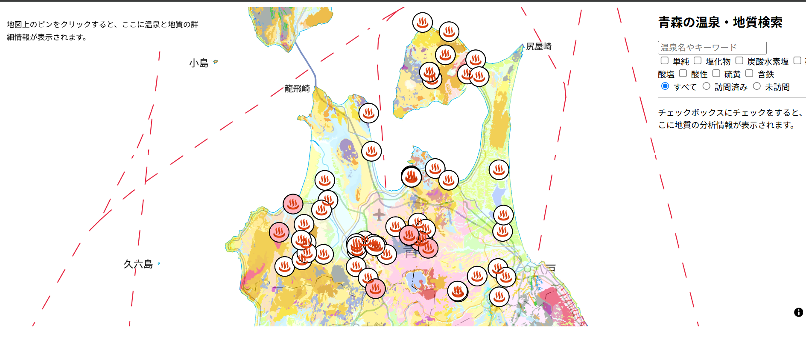
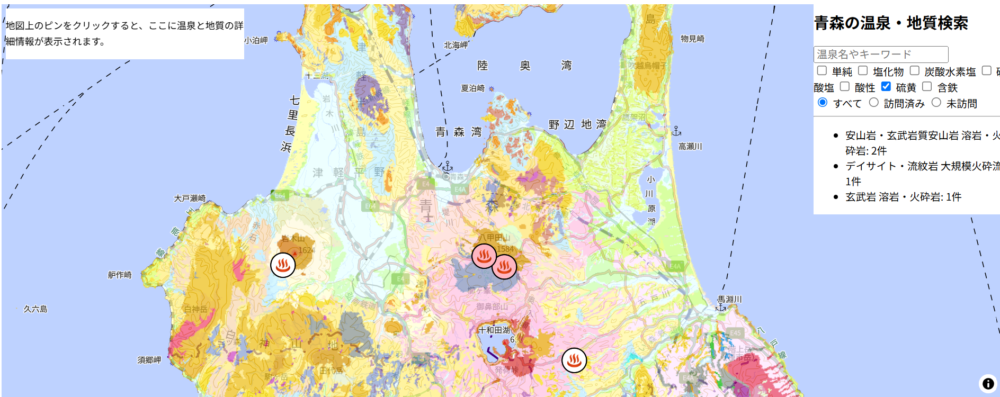
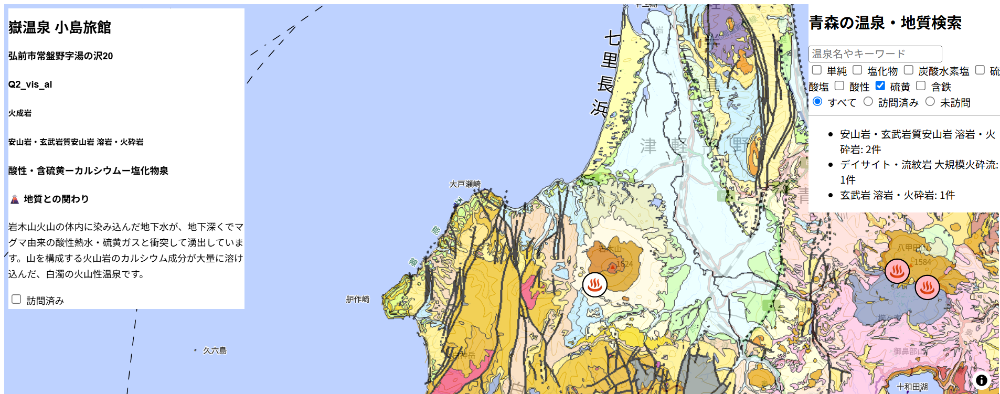
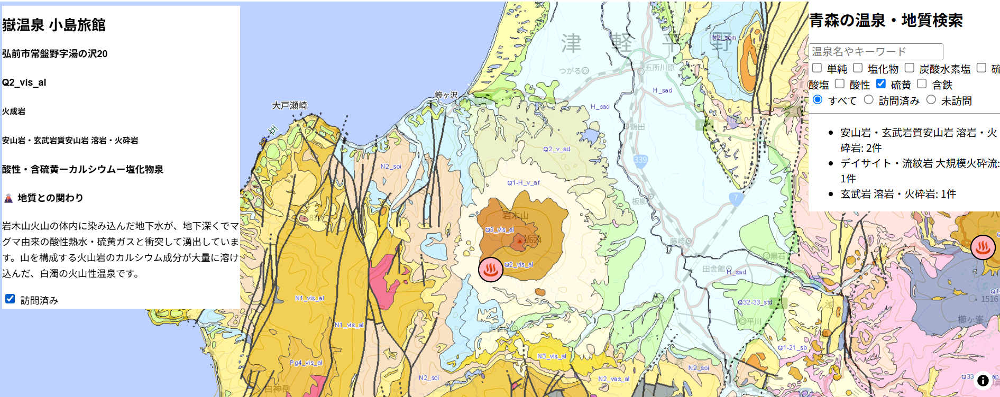

## 温泉の泉質×地質の可視化@青森  
青森県の温泉施設と地質図を重ねて表示し、温泉の性格を地質との関りを直感的に把握できるWebGIS。  
温泉施設を選択すると、泉質や施設情報、地質との関連を閲覧できる。  
また、温泉名や泉質でフィルター検索機能を備える。

## 経緯  
移住のきっかけのひとつである温泉を地形的な背景から理解したいと考えたため。  
雄大な自然を持つ県だからこそ、全体の地形とその特徴をざっくりと把握しておき、  
今後の青森生活をより豊かに楽しく過ごすため。

## 機能概要  
- 温泉情報の表示
　地物をクリックすると、画面左側に選択した温泉の情報を表示する
　表示項目：施設名、住所、地質区分、泉質、地質との関わり(一部のみ※)

- フィルター機能
以下の操作により、マップ上に表示する地物にフィルターをかける
 キーワード入力　：施設名、泉質を部分一致検索
 チェックボックス：泉質を部分一致検索
 ラジオボタン　　：訪問済/未訪問/すべてで検索

※記載がある施設  
不老不死温泉（外ヶ浜町）、熊の湯温泉、酸ヶ湯温泉、海峡保養センター、稲垣温泉ホテル花月亭、嶽温泉 小島旅館、鰺ヶ沢温泉

## 使用技術
HTML,JavaScript,MapLibre GL JS,FastAPI,PostgreSQL

## データ出典  
- 温泉データ：国土数値情報(観光資源データ＞観光資源分類コード=3(温泉・健康))
- 地質データ：20万分の1日本シームレス地質図V2
- 背景　　　：国土地理院

## 画像
1.初期表示

2.泉質：硫黄で検索

3.地物をクリックして温泉情報と地質を表示

4.チェックを付けて訪問済みにする
